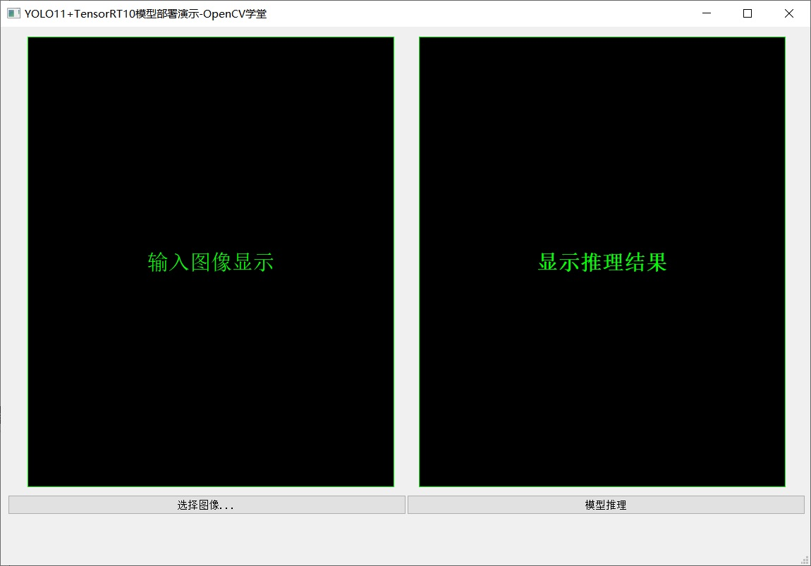
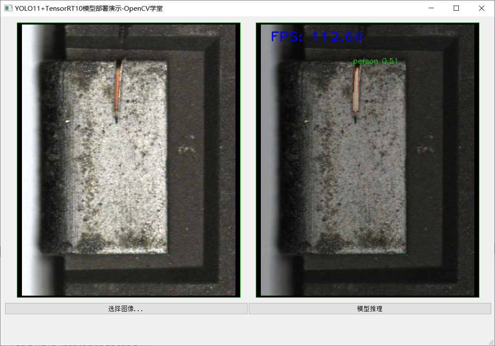

### YOLO Infer APP
QT5 + TensorRT10.x + OpenCV4.10 + VS2022
Jetson Orin Nano C++ supported!
YOLO Segmenat Models including YOLOv8, YOLO11, YOLO26 can deploy with it

### 第三方库依赖
```
- OpenCV4.x\OpenCV5.x
- CUDA11.x\CUDA12.x\CUDA13.x
- TensorRT8.x\TensorRT10.x
```



#### 安装指南
下载代码，导入到新建的QT Creator项目中即可，选择全部覆盖，然后自己依赖库安装与路径修改即可运行。

### 模型转换
模型提供了ONNX格式，engine格式模型跟设备算力是强相关，无法做到设备兼容，所以需要使用下面的命令行转换为engine格式：
trtexec.exe --onnx=yolov8_cu.onnx --saveEngine=yolov8_cu.engine

### 特别提示 - 新手慎入！！

### OpenCV学堂课程主页
https://appetjpz4tj8166.h5.xet.pomoho.com/

### OpenCV实验大师工具软件下载地址（OpenCV算子工作流设计软件）- 腾讯网盘
https://share.weiyun.com/tgoxerG9

### YOLO、OpenCV C++教程 - QT集成版本
https://appetjpz4tj8166.h5.xet.pomoho.com/v1/goods/goods_detail/p_66d65341e4b023c06c898401?type=3&channel_id=

### 合作联系
OpenCV与深度学习开发合作

微信: bfnh2qxx (注明：合作)

技术讨论QQ群: 934105010 (注明: 学习)


